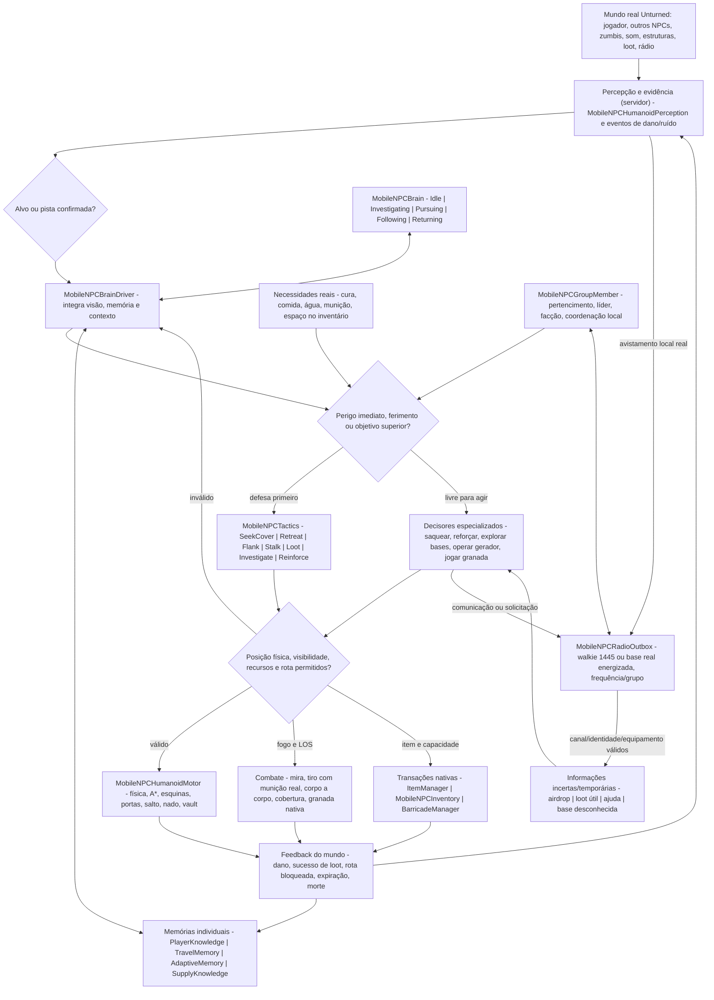

# Cérebro dos NPCs móveis — arquitetura e fluxos de decisão

> **Estado em 2026-10-14:** documentação de estrutura real do código da branch `feature/npc-ai-foundation`. Não representa uma IA já validada na Dev Build. O núcleo `MobileNPCBrain` é uma máquina de estados; `MobileNPCTactics` é uma segunda camada de objetivos e os componentes especializados inserem decisões. Não há modelo neural nem uma única behavior tree central. As ligações abaixo descrevem integrações em código, não uma garantia de comportamento validado.

## Ordem de prioridade conceitual

1. **Segurança e estado vital:** morrer, dano, fogo recebido, fuga, cobertura e ameaça visual confirmada têm precedência sobre loot e patrulha. Nenhum rádio deve conceder automaticamente um alvo nem permitir tiros através de paredes.
2. **Combate confirmado:** visão física do alvo, arma real, munição, distância, precisão humanizada, linha de fogo segura, recarga, oportunidade de granada com inventário/risco e decisão de recuo.
3. **Grupo e tarefas legítimas:** guarda, líder, companheiro e coordenação de aliados, com rádio condicional. Informação de aliados gera pista com confiança e prazo, não onisciência.
4. **Sobrevivência e inventário:** água/comida, ferimentos, magazines compatíveis, loot verificável, construção/base, suprimentos reais, combustível e energia.
5. **Exploração autônoma:** objetivos ociosos e rumores de airdrop, loot útil e estruturas desconhecidas, sempre com destinações aproximadas, prazo limitado e confirmação local.

## Maquinário real e pontos de integração

| Módulo | Classe principal | Envia para |
|---|---|---|
| Percepção / visão | `MobileNPCHumanoidPerception` | `MobileNPCBrainDriver.ReportVisibleTarget` |
| Estado de decisão | `MobileNPCBrain` | `Idle/Investigating/Pursuing/Following/Returning` |
| Arbitragem de destino | `MobileNPCTactics` | `SeekCover/Retreat/Flank/Stalk/Loot/Investigate/Reinforce` |
| Rota / física | `MobileNPCHumanoidMotor`, `MobileNPCDoorNavigation` | Mundo e `ReportDestinationReached` |
| Combate básico / de longe | `MobileNPCHumanoidCombat`, `MobileNPCHumanoidRangedCombat` | APIs de dano e tiro existentes |
| Granada | `MobileNPCGrenadeThrower` e `MobileNPCGrenadeNPCSplash` | `ItemThrowableAsset`, Rigidbody, `Grenade`, `DamageTool` |
| Rádio / grupo | `MobileNPCGroupMember`, `MobileNPCRadioOutbox`, `MobileNPCBaseRadioStation` | Mensagem com TTL e destinatário elegível |
| Airdrop | `MobileNPCAirdropContest`, `MobileNPCAirdropRumor` | Investigar e revalidar crate `CarepackageDestroy` |
| Loot | `MobileNPCLooting`, `MobileNPCUsefulLootRumor` | `ItemManager`/inventário real |
| Ajuda via rádio | `MobileNPCReinforcementResponse` | `Goal.Reinforce` |
| Base desconhecida | `MobileNPCUnknownBaseIntel` | Inspecionar estruturas `StructureDrop` de `owner != 0` e aproximar com cautela |
| Estação de rádio / energia | `MobileNPCSettlementBuilder`, `MobileNPCBaseGeneratorOperator` | `BarricadeManager`, gerador nativo, combustível real |
| Memória / necessidades | `MobileNPCAdaptiveMemory`, `MobileNPCTravelMemory`, `MobileNPCSupplyKnowledge` | Valor de pistas, escolha de suprimentos, feedback |

**Atenção para o primeiro teste:** o diagrama é uma representação de arquitetura, não uma árvore totalmente formalizada com precedência global garantida. Dependendo do ciclo `Update` de cada componente, duas decisões podem competir. Verificar priorização e cancelamento de objetivos, navmesh/A*, dano de explosivos em NPCs, segurança de aliados e física em testes reais. `UnknownBase` usa apenas estruturas nativas com proprietário real `owner != 0`; NPC base sem `owner` persistente não é identificada como rival. `Grenade` usa efeito e explosão nativos, mas a extensão exclusiva de dano aos MobileNPCs ainda depende de avaliação de LOS/dano em jogo.

**Estados dos novos marcos:** `COM-UNKNOWN-BASE-RADIO-01` e `NPC-GRENADE-01` com fonte integrada e aguardando Dev Build. Itens e sistema do Unturned sem cobertura runtime são pendentes, não considerados concluídos.
